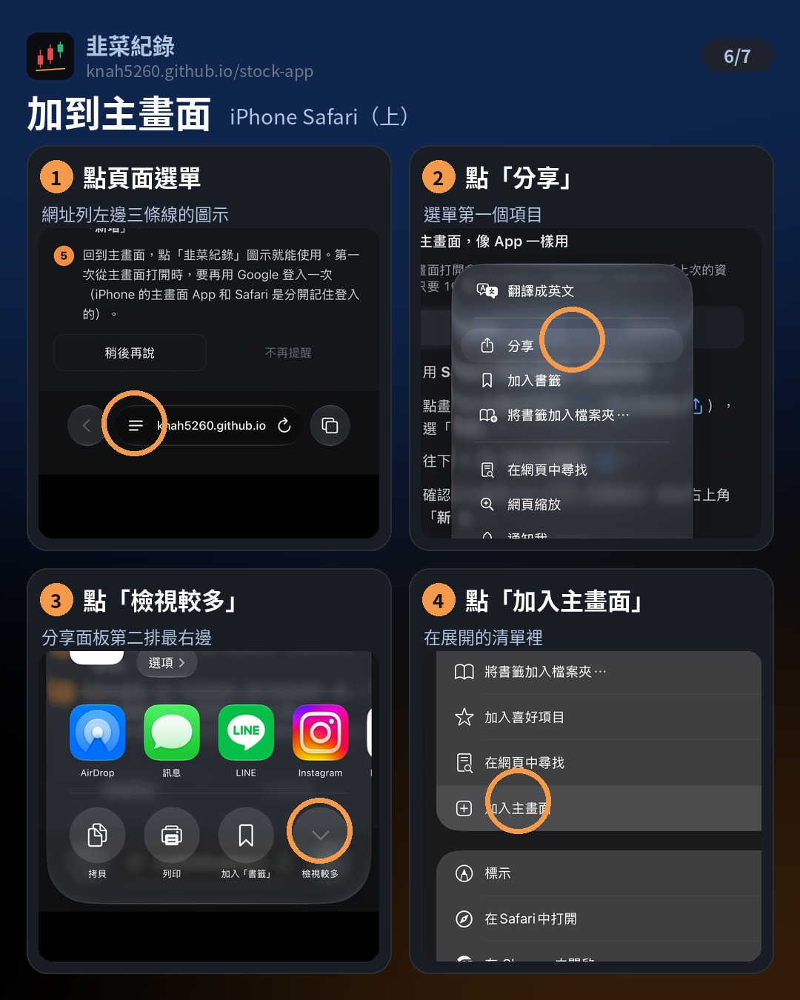
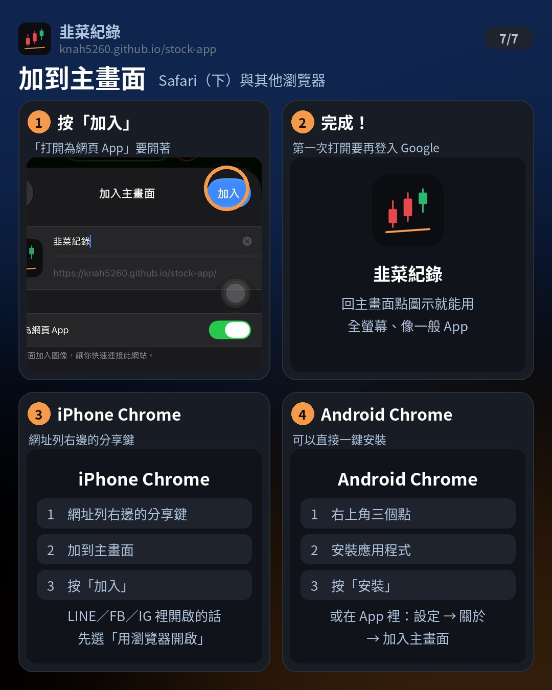
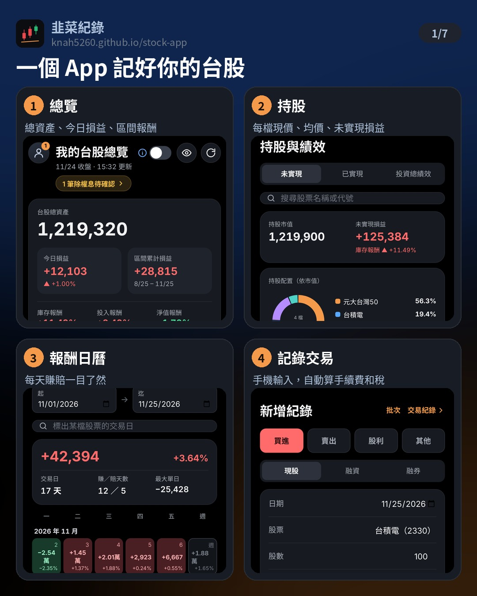
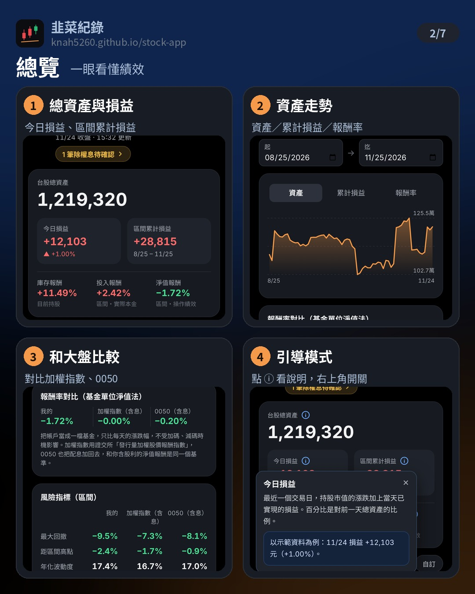
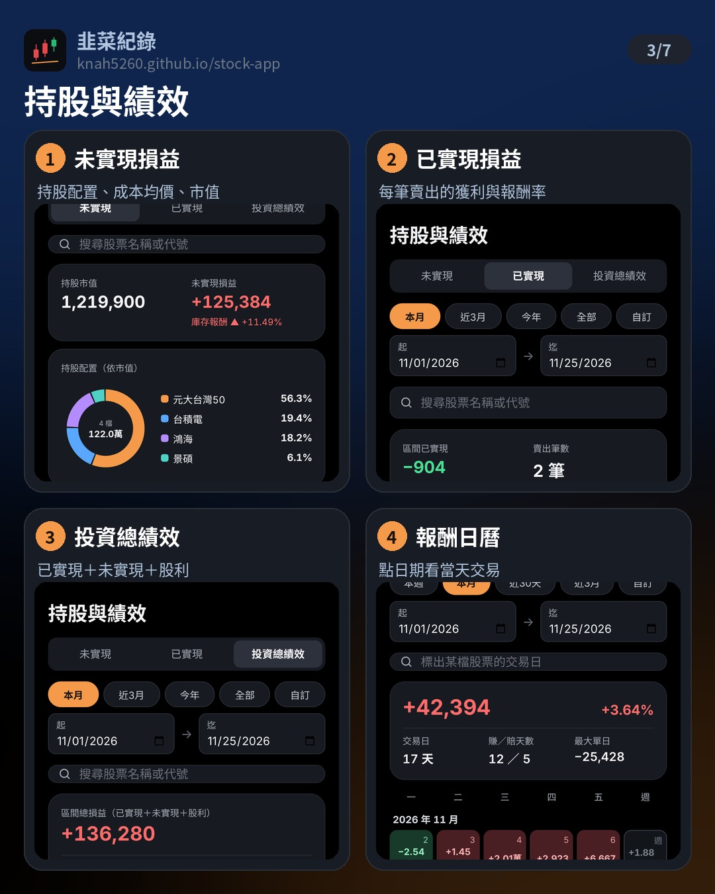
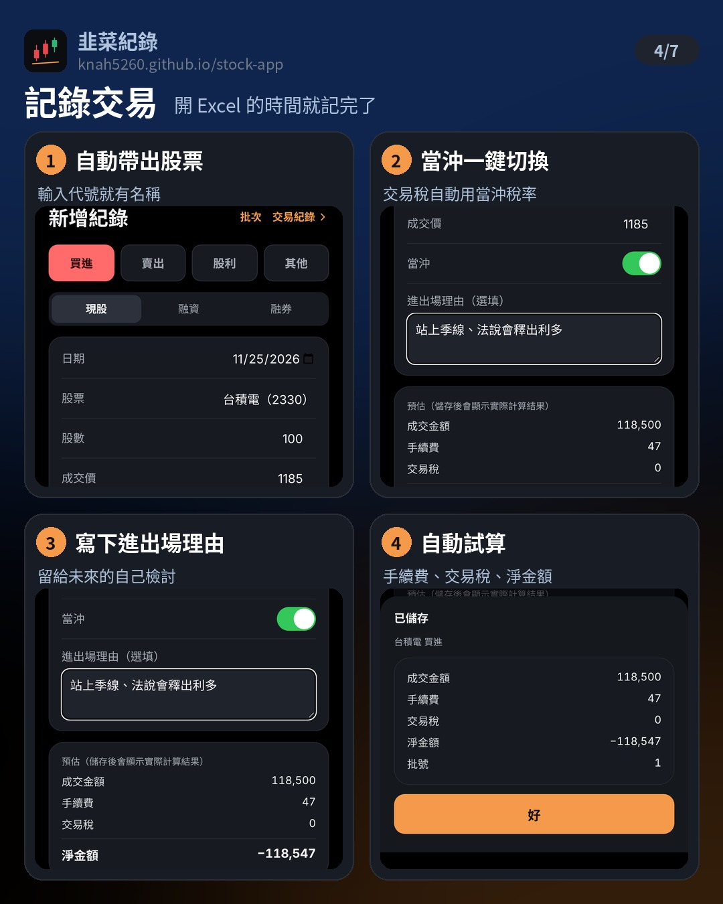
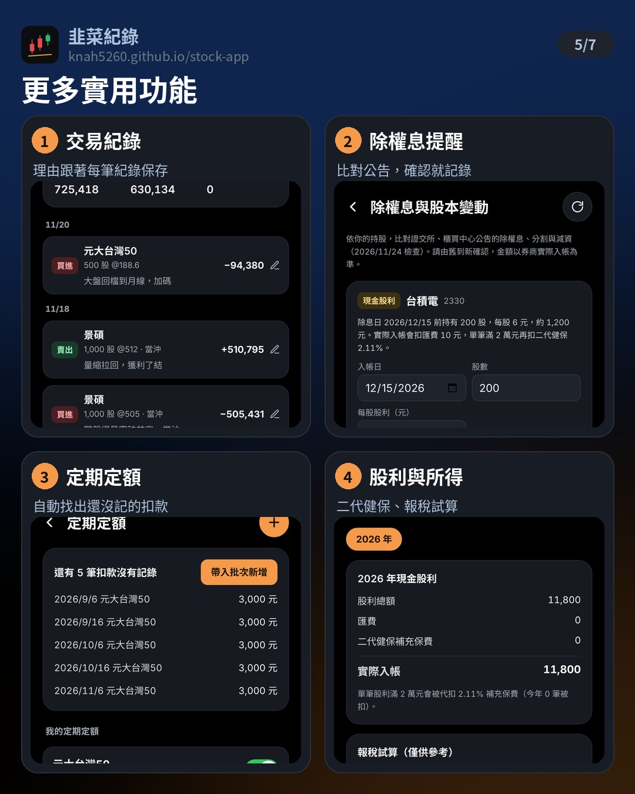

# 韭菜紀錄

**一個專為台股設計的投資記帳 App。** 打開手機就能記下每一筆交易，手續費、稅金、成本、損益都自動算好。

👉 https://knah5260.github.io/stock-app/

不用下載、不用註冊新帳號，用 Google 帳號登入就能開始；不想登入也可以先用示範資料逛一圈。

---

## 開始使用

1. 打開 https://knah5260.github.io/stock-app/
2. 先看看示範資料，或按上方「登入使用」，用 Google 帳號登入
3. 第一次登入時，App 會在你的雲端硬碟建立「韭菜紀錄（App 資料）」
4. 到「交易」新增第一筆紀錄，或到「設定」先調整券商的手續費折數

> **📌 股價更新時間**：App 用的是收盤價，不是盤中即時價。每個交易日 **15:40** 更新當天收盤價，**21:10** 再檢查一次並補齊資料。所以盤中打開時，市值和未實現損益是用**前一個交易日的收盤價**計算的。

### 加入主畫面

https://github.com/user-attachments/assets/4ccc4cac-4694-4cfc-998b-8c59cc9fc7bd

從主畫面打開會全螢幕顯示、開得更快，離線也能看上次的資料。用瀏覽器打開時，App 也會自動跳出這份教學（之後可在「設定 → 關於 → 加入主畫面」再打開）。

**iPhone／iPad（Safari，iOS 26）**

1. 點畫面下方網址列**左邊**的頁面選單 
2. 在選單裡點「**分享**」
3. 分享面板第二排點「**檢視較多**」
4. 往下找到並點「**加入主畫面**」
5. 確認「**打開為網頁 App**」是開啟的，按右上角藍色的「**加入**」
6. 回到主畫面點「韭菜紀錄」圖示。第一次從主畫面打開時要再用 Google 登入一次（主畫面 App 和 Safari 是分開記住登入的）

iOS 18 以前的 Safari：直接點下方工具列的分享按鈕 ，再往下點「加入主畫面」。

**iPhone／iPad（Chrome）**

1. 點網址列右邊的分享按鈕 
2. 在選單裡點「**加入主畫面**」（找不到就往下滑，或點「更多」）
3. 按右上角「**新增**」，回到主畫面點「韭菜紀錄」圖示

需要 iOS 16.4 以上；加不進去時請改用 Safari。

**Android（Chrome）**

1. 點右上角的選單 
2. 點「**安裝應用程式**」或「**加到主畫面**」
3. 按「**安裝**」，完成後從主畫面或應用程式清單打開「韭菜紀錄」

App 偵測到 Android 的 Chrome 時，也會直接提供「一鍵安裝」按鈕。

**在 LINE、Facebook、Instagram 裡打開的話**

這些 App 內建的瀏覽器沒辦法加到主畫面，Google 登入也可能失敗。請點右上角（或右下角）的選單，選「以 Safari 開啟」或「用 Chrome 開啟」，再照上面的步驟操作。

換手機或用其他裝置，只要登入同一個 Google 帳號，資料就會同步。

## 功能

### 功能演示影片

https://github.com/user-attachments/assets/f0cde64c-d5d7-4146-9403-ca20b7dc8336

### 圖文介紹

### 功能列表

**記錄**
- 現股、零股、當沖、融資、融券、融資現償、保證金追繳
- 現金股利、股票股利、股票分割、減資、現金增資
- 每筆交易可寫進出場理由
- 批次新增、定期定額自動帶入扣款日收盤價
- 除權息與股本變動提醒：比對證交所、櫃買中心公告，找出還沒記錄的配息配股

**分析**
- 台股總資產、今日損益、區間累計損益
- 庫存報酬、投入報酬、淨值報酬（基金單位淨值法）
- 與加權報酬指數、0050 含息比較
- 最大回撤、波動度、每月報酬熱力圖、報酬日曆
- 未實現、已實現、每檔每批的投資總績效
- 股利與所得年度整理

**其他**
- 多帳戶（不同券商分開記帳，也可看全部合計）
- 匯出詳細 CSV（含手續費、稅、成本、損益和進出場理由）
- 隱藏金額模式、引導模式、示範模式
- 支援 iPhone、iPad、Android 和電腦，可加入主畫面當 App 使用，離線也能打開

## 開發理念

### 1. 讓記錄投資變簡單

很多人知道該記帳，卻總是撐不久。原因很簡單：每次成交後都要打開電腦、開 Excel、找到那張表、往下捲到最後一列、手動算手續費和稅……麻煩到最後乾脆不記了。

韭菜紀錄想把這件事縮短成**在手機上花十秒**：選買或賣、輸入股票、股數、價格，按儲存。手續費（含折扣）、證交稅、二代健保、融資利息、批號和先進先出成本，全部由 App 自動處理。剛成交的那一刻就記下來，不用累積到週末再補。

### 2. 為什麼投資一定要記錄

- **看清楚真實的績效。** 只看券商 App 的庫存損益，很容易忘記已經賣掉的虧損、付掉的手續費和稅。把每一筆都記下來，才知道這一年到底賺了還是賠了。
- **知道自己有沒有贏過大盤。** 如果長期報酬比不過買 0050 放著，那花時間選股的意義就值得重新思考。App 用基金淨值法把你的報酬和加權指數、0050（都含息）放在一起比，數字不會說謊。
- **從錯誤中學習。** 人的記憶會美化過去，賺錢的單記得很清楚，賠錢的單很快就忘了。每筆交易都可以寫下「進出場理由」，事後回頭看，才能分辨哪些是判斷正確、哪些只是運氣。
- **報稅與對帳更輕鬆。** 股利、二代健保補充保費按年度整理好，報稅時直接對照；每筆手續費和稅都算到元，可以和券商對帳單互相核對。
- **控制風險。** 持股配置、最大回撤、波動度、融資到期與維持率提醒，讓你在問題變大之前就看得到。

### 3. 你的資料只屬於你

交易紀錄存在**你自己 Google 雲端硬碟裡的一份試算表**。App 沒有自己的伺服器，開發者看不到、也不會收集你的任何資料。Google 授權也只要求最小權限：App 只能讀寫它自己建立的那一份檔案，看不到你雲端硬碟裡的其他東西。

就算哪天不用這個 App 了，資料還是完整留在你的雲端硬碟，隨時可以打開、下載或匯出 CSV。

### 4. 算得跟券商一樣準

計算方式完整照台股規則：手續費折扣可依日期分段、整股與零股最低手續費、股票 0.3%／ETF 0.1%／現股當沖 0.15%／債券 ETF 免稅、單筆股利 2 萬元以上的二代健保、融資融券的擔保品、保證金和利息。同一檔分批買賣會自動分批號，成本採先進先出（FIFO）。

### 5. 不懂也能上手

開啟右上角的**引導模式**，每個數字和功能旁邊都會出現 ⓘ，點開就會說明它代表什麼、怎麼算，還會直接帶入你自己的數字當例子。投資新手也能看懂「庫存報酬」「投入報酬」「淨值報酬」差在哪裡。

### 6. 為什麼叫「韭菜紀錄」

在台股，大家多少都當過韭菜。這個名字是自嘲，也是提醒：**誠實記下每一次進出場，才是不再當韭菜的第一步。**

---

## 資料來源

股價、指數、代號表與除權息資訊，來自臺灣證券交易所與證券櫃檯買賣中心的公開資料，每個交易日 15:40 與 21:10 由 GitHub Actions 自動更新（股價為收盤價，不是盤中即時價）。

## 技術架構

整個 App 是放在 GitHub Pages 的靜態網頁，沒有後端伺服器。

| 檔案 | 用途 |
| --- | --- |
| `index.html` | App 畫面 |
| `engine.js` | 計算引擎：手續費、稅、FIFO 成本、融資融券利息 |
| `localapi.js` | Google 登入、讀寫使用者的試算表、整理各頁資料 |
| `demo.js` | 示範模式的假資料 |
| `sw.js` | 背景程式：可安裝、離線開啟 |
| `scripts/fetch-data.mjs` | 每天抓公開資料，存到 `data/` |
| `.github/workflows/data.yml` | 排程執行上面的抓資料程式 |

## 版本紀錄

見 [CHANGELOG.md](CHANGELOG.md)，App 裡的「設定 → 關於 → 更新內容」也看得到。

## 隱私與條款

- [隱私權政策](https://knah5260.github.io/stock-app/privacy.html)
- [使用條款](https://knah5260.github.io/stock-app/terms.html)

## 免責聲明

本 App 僅供個人記帳與參考，不構成任何投資建議。計算結果可能與券商實際金額有些微差異，手續費、稅金、股利與二代健保補充保費請以券商及相關單位的通知為準。

## 版權

© 2026 knah5260，保留所有權利。

本 repo 公開原始碼僅供瀏覽，未授權任何人複製、修改、散布或用於商業用途。如需使用請先聯絡作者。

## 問題回報

請到 [Issues](https://github.com/knah5260/stock-app/issues) 留言。
